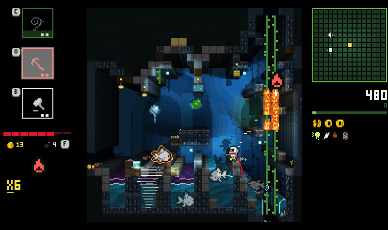

# Inward

I've found that doing anything with LLMs can be a real exercise in maximalism. Instead of seeing the elegant statue inside the marble block, you build grotesque statues out of marble blocks. The incentive to reduce for simplicity is pretty much entirely absent. So it is, with this game, which started out intending to be some kind of mashup between Metroid on the original Game Boy and Noita (which, to be fair, isn't the most minimalist design brief).

I dunno, I just have a thing for surprising emergent gameplay interactions. However, without careful design (which I did NOT apply in this game) you don't really get emergent interactions - you pretty much just end up with 'everything goes on fire'.

Anyway, I was in the mood to see how far modern models can take something like this - even though I was pretty bored with the primary game design after the first prototype - and from a technical perspective I found myself impressed again and again. From the technical side I think this project would have taken weeks to months, and it's hard to get over how much in the future we live.

I'm hoping that my actual appetite for game design itself will be reflected in one of these games some day! It's not this one, though. On the other hand it _is_ fun to play in a certain way - perhaps more as a feat of modern times moreso than as a fun game.

A possible remix direction would be to remove enemies entirely, and have some kind of procedurally-generated Metroidvania map that rewards experimenting with the  interactions without the boring enter-room-kill-enemies-next-room loop. I think that would likely be a better game, but I'm already on to my next ~~pile of rocks~~ beautiful statue!

## Controls

- Arrow keys or WASD
- Z to jump, X to shoot, C V B for skills
- P or Escape to Pause
- Even includes controller support

Also works on mobile.
